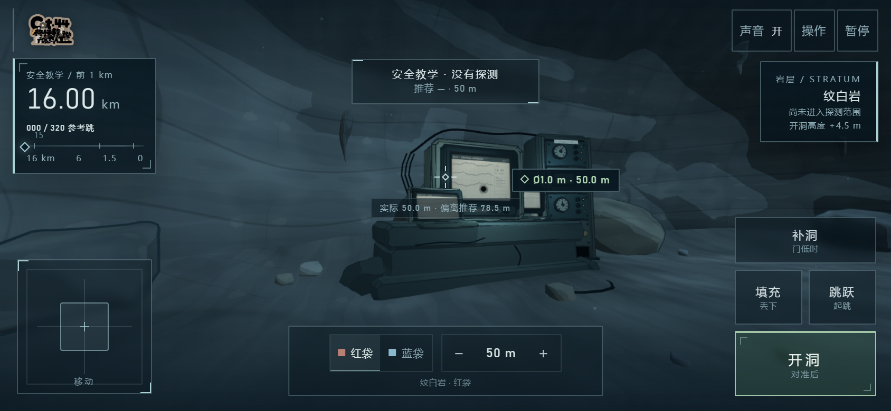
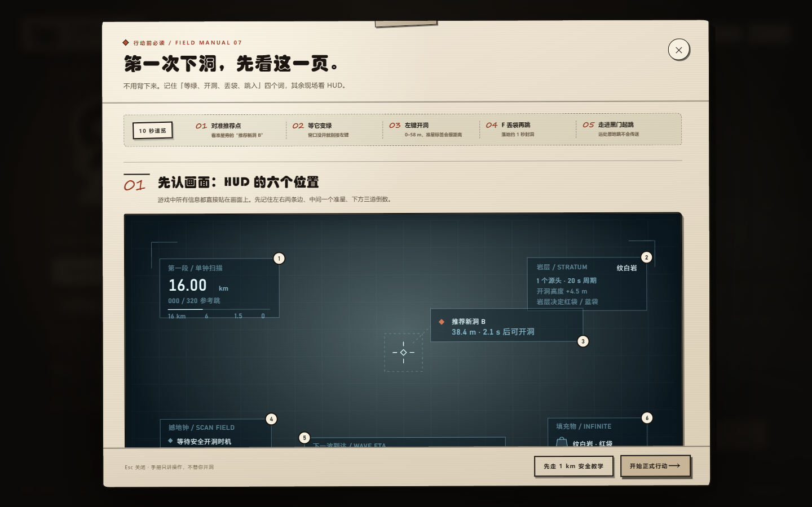
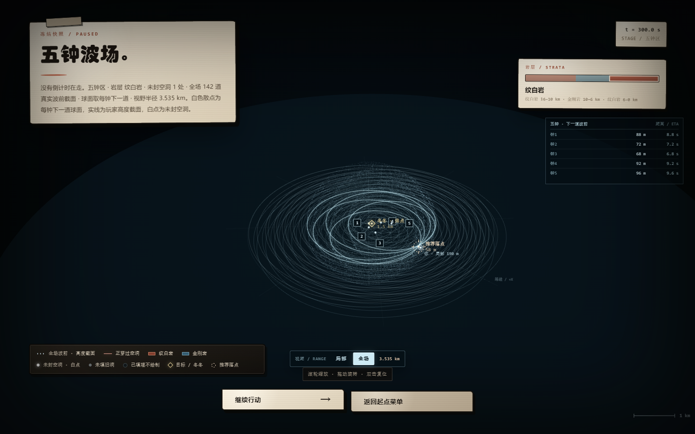

# 冬冬拯救行动方案五

> RESCUE DONGDONG · 离线运行的三维洞穴波前救援小游戏

在岩层之下，靠撼地钟的扫描波判断安全时机，开洞、填充、跳跃，一路接近冬冬。
纯前端实现（HTML + CSS + 原生 JavaScript + Three.js），不需要联网，也不需要构建或本地服务器。



## 立即游玩

**桌面 / 笔记本**

1. 下载或克隆本仓库。
2. 用 Edge 或 Chrome 打开根目录的 `index.html`。
3. 首次进入先看「新手教程」，或直接走一遍「1 km 安全教学」。

需要浏览器开启硬件加速；直接双击 `file://` 打开即可，不必起服务器。

**手机 / 平板**

直接打开 [`dist/营救东东-手机单文件版.html`](dist/营救东东-手机单文件版.html)。
这是一个约 8 MB 的单文件版本：脚本、样式、贴图、24 个音效和两首 BGM 全部内联，
拷进手机用浏览器打开就能玩。推荐横屏；触屏控件会自动出现，也可在
「老君的法宝（加强版） → 操作方式」里强制切换自动 / 键鼠 / 触屏。

## 新手教程

开始菜单点「新手教程」，会打开一页行动前手册：HUD 的六个位置、中央下方三个倒数分别代表什么、
「等绿 → 开洞 → 丢袋 → 跳入」四步流程、键鼠与触屏键位对照、16 km 分段与填充袋颜色，
以及四个常见失误。手册里的图是可读的 2D 示意图，不随实战数值变化。

三个倒数不是同一个计时器，而是同一道真实波前到达三个不同位置的剩余时间：

- **OWN / 当前洞**：你脚下这个洞下一次被扫描波碰到还有几秒。
- **CURSOR / 光标落点**：准星指着的岩壁还有几秒被碰到。
- **PLAN / 推荐位置**：顾问给的下一处落点还有几秒被碰到；窗口没开时倒数开门波，变绿后倒数关门波。

数字小于 1.5 秒会变红；显示「—」表示这一段没有扫描波，或当前没有有效落点。
手册底部可以直接「先走 1 km 安全教学」，也可以「开始正式行动」。



## 玩法

行动全程 16 km，分为三个阶段：

1. **单钟扫描（16–6 km）**：一个源头，20 秒周期。首 1 km 为安全教学，没有探测，可随时开洞。
2. **静默段（6–1.5 km）**：对方察觉后停机，可按住 Shift / 长按「快进」快速推进。
3. **五钟区（1.5–0 km）**：五个源头逐台重启，波前先在岩层里走一段路，再进入扫描。

核心循环：

- 用 WASD / 摇杆在洞内移动，空格 / 跳跃键真实起跳。
- 鼠标 / 触屏转向，把准星对准推荐落点；滚轮 / ± 调整开洞斜距（≤ 58 m）。
- 开启「轻吸附推荐落点」后，转向停稳（鼠标约 0.13 秒）或触屏松手时，
  准星只要在推荐方向约 14° 内就会自动吸住；继续拖动立即恢复自由瞄准，
  滚轮 / ± 选择的距离也不会被覆盖。
- **等亮蓝再开洞**：真实扫描波与空洞球体相交就会命中。提前开洞不会被拦，但会被真实波场发现。
- 按 F / 「填充」丢下填充物，落地 1 秒后封洞；走近黑门后跳入传送。
- 岩层从外到内为 纹白岩 → 金刚岩 → 纹白岩（16–10 / 10–6 / 6–0 km）。
  纹白岩用红袋，金刚岩用蓝袋，换层要换袋。
- 门开低时，1.5 秒内按鼠标中键 / 「补洞」原地补救。
- 扫描命中消耗生命；生命耗尽需重新开始。进度自动保存在浏览器本地。

菜单里的「老君的法宝（加强版）」可以调整操作方式、行动距离、生命值，
以及轻吸附推荐落点、自动丢袋 / 换袋 / 跳跃等辅助。

## 操作

| 动作 | 键鼠 | 触屏 |
| --- | --- | --- |
| 移动 | WASD | 左下虚拟摇杆 |
| 转头 | 移动鼠标（V 锁定 / 右键拖动） | 右侧画面拖动 |
| 跳跃 | 空格 | 「跳跃」 |
| 开洞 | 鼠标左键 | 「开洞」 |
| 调整开洞距离 | 滚轮 | 底部「− / ＋」 |
| 切换红袋 / 蓝袋 | 1 / 2 | 底部袋名按钮 |
| 丢填充物 | F | 「填充」 |
| 原地补洞 | 鼠标中键 | 「补洞」 |
| 快进等待 | 按住 Shift | 按住「快进」 |
| 暂停 / 3D 地图 | Esc | 右上「暂停」 |
| 操作说明 | H | 右上「操作」 |

## 暂停地图

暂停会冻结所有计时，地图按当前引擎状态绘制，等待不会改变它。

- 前三段（平面）：俯视剖面，显示真实波前、空洞、推荐落点与目标。
- 五钟区（三维）：可环绕、缩放、平移、双击复位。
  - **局部**：以玩家为中心的 190 m 调查球，适合看眼前一步。
  - **全场**：自适应框住当前真实波场，显示全部五个源头、每钟下一道波前、
    历史波环、未封空洞、路线与目标，并给出真实视野半径。



## 目录

```
rescue-dongdong/
├─ index.html                 # 桌面版入口
├─ style.css / pause-map.css / touch.css
├─ engine.js                  # 波场、推进、胜负、存档
├─ player.js                  # 移动、跳跃、视角
├─ scene.js                   # Three.js 洞穴与开洞门
├─ pause-map.js               # 2D / 3D 冻结地图
├─ touch.js                   # 触屏输入与布局
├─ game.js                    # UI、流程、音效与辅助
├─ vendor/three.min.js        # Three.js（MIT，附许可证）
├─ assets/                    # Logo、头像、24 个音效
├─ dist/营救东东-手机单文件版.html
├─ tools/build-mobile-single.mjs
└─ docs/                      # README 截图（含新手教程）
```

## 构建单文件版

需要 Node.js 18+：

```bash
node tools/build-mobile-single.mjs
```

脚本会把 3 个 CSS、7 个脚本（含 Three.js）、图片与音频全部内联到
`营救东东-手机单文件版.html`，并检查页面不再引用任何外部文件。
本仓库 `dist/` 中已附带构建好的版本。

## 验证说明

开发期使用本机 Edge 无头模式 + CDP 在真实时钟下走完整流程，覆盖桌面与触屏布局、
三段波场、寻路推荐、存档恢复、BGM 切换、暂停地图局部 / 全场切换等
（发布版触屏与流程 216 项、新手教程 76 项、轻吸附 20 项、地图 67 项，均通过；
教程套件同时覆盖桌面、手机横屏、手机竖屏和手机单文件版）。截图与验证产物未随仓库发布。

## 版权与致谢

本项目是《罗小黑战记》的非商业同人作品，仅供学习、交流与个人游玩。

- 角色「冬冬」「小黑」「老君」、白游头像、作品 Logo 及相关设定版权归
  原作作者 MTJJ / 寒木春华及相应权利人所有。
- BGM 使用《罗小黑战记2》官方 OST 中的「14_追踪若木」与「16_灵力追踪」，
  音乐版权归原作曲者与发行方所有。
- [Three.js](https://threejs.org/) 以 MIT 许可证分发，许可证见 `vendor/THREE-LICENSE.txt`。

仓库公开不等于授权商用或再分发素材。请勿将本作或其中素材用于商业用途；
如权利人认为本仓库内容不妥，请联系删除，会立即处理。
